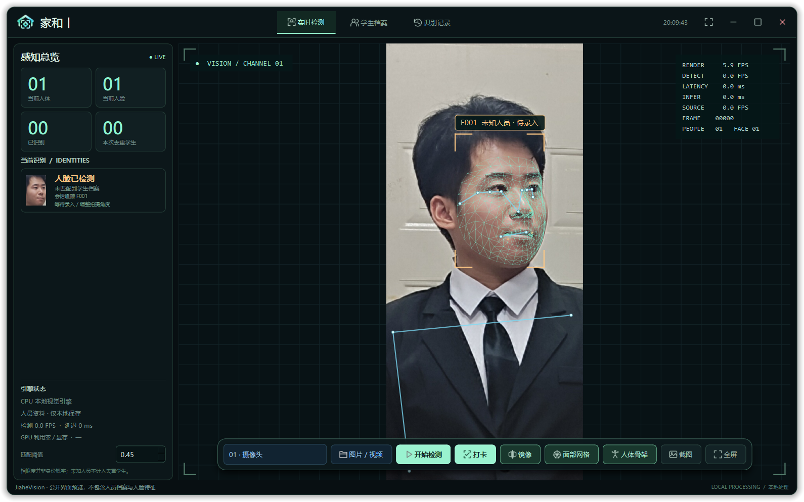

# JiaheVision · 家和丨

基于 PyQt6、OpenCV、Pillow、ONNX Runtime CPU 和 MediaPipe 的 Windows 桌面视觉检测程序。



## 功能

- 人体与人脸检测、中文姓名学号、本地身份匹配、追踪 ID 及平滑框。
- 面部网格、人体骨架与关节点，可独立开关。
- 摄像头编号与名称下拉切换、设备重扫、镜像开关。
- 图片/视频分析，手动打卡保存检测截图和人员资料，支持搜索及 CSV 导出。
- 实时 FPS/延迟/人数/资源指标，预览与推理分离，自动调整检测频率。
- HUD、SVG 图标、窗口拖动及八方向缩放、F11 全屏与 Esc 退出。

## 运行

Windows 10/11 x64，建议 Python 3.12，无需 CUDA：

```powershell
python -m venv .buildenv
.buildenv/Scripts/python.exe -m pip install -r requirements.txt
.buildenv/Scripts/python.exe download_models.py
.buildenv/Scripts/python.exe download_landmarks.py
.buildenv/Scripts/python.exe main.py
```

首次运行后在「学生档案」录入自己的授权照片。源码版数据保存在 data，安装版位于当前用户 LocalAppData/JiaHeVision/data。

公开仓库不包含预录人脸特征、人员资料、数据库及打卡记录。界面预览使用用户授权的照片，不显示人员档案信息。本次仅发布源码和界面图片，不发布 Release。

## 验证和打包

窗口回归：`.buildenv/Scripts/python.exe verify_window.py`。本机约 10 秒短测：预览约 29.6 FPS、检测约 7.7 FPS，实际速度随硬件及场景变化。

构建配置位于 packaging；使用独立 .buildenv 和项目内 .tools/InnoSetup/ISCC.exe，执行 packaging/build.ps1。可先运行 packaging/prepare_cpu.py 延迟加载未使用的 3D 绘图依赖。预录种子可选，公开源码默认从空档案开始。

模型来自 OpenCV Zoo、YOLOv8 ONNX 和 Google MediaPipe；下载地址见 download_models.py 与 download_landmarks.py。
